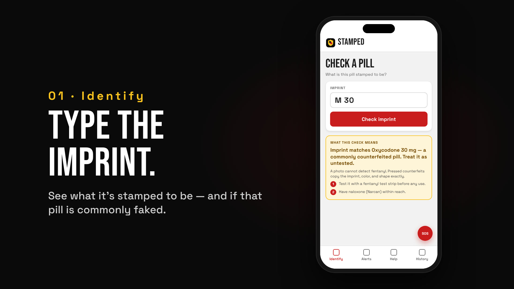

# Stamped

**Pill ID and fake-pill alerts for people who use pills or powders that didn't come from a pharmacy.**

A photo cannot detect fentanyl. A $1 test strip can. Stamped tells you what a pill is stamped to be, whether that type is being counterfeited near you, and how to test it. You can log a fentanyl test strip result without an account. Naloxone and help are one tap away.



**Live:** [pill-checkr.lovable.app](https://pill-checkr.lovable.app) · iOS app in App Store review

## Why it exists

Counterfeit pills pressed to look like oxycodone or Xanax often contain fentanyl, and they copy the real imprint, color and shape exactly. Pill-ID sites built for pharmacists answer "what is this?" but never "is this type being faked right now, near me?" Stamped answers that question and points every result toward testing, never toward "safe."

## What it does

| Tab | What you get |
|---|---|
| **Identify** | Type an imprint (like `M 30`) or snap a photo. See what it is stamped to be and whether that imprint is commonly counterfeited. |
| **Alerts** | A map of lab detections, medical examiner reports, EMS overdose responses and official advisories near you. |
| **Help** | Naloxone, test strips and support nearby, plus an SOS button on every screen. |
| **History** | Your past checks and strip results. |

## Design rules

- **No "safe" state, anywhere.** No green results and no confidence percentages. A result is either unidentified (red) or identified but untested (amber).
- **Guest first.** Identifying, alerts, the help map and strip logging all work without an account.
- **Evidence stays separate.** A lab detection, a death and a 911 call mean different things. They live in separate tables and are labeled by source. See [DATA_SOURCES.md](DATA_SOURCES.md).
- **Privacy by construction.** Nothing published is more precise than an H3 cell of about 36 km². No names, ages or addresses are stored.

## Stack

React 18, TypeScript, Vite, Tailwind and shadcn/ui on the front end. Supabase (Postgres, edge functions, row-level security) behind it. Leaflet with H3 hex cells for the map. Capacitor 7 for the iOS app. Web and iOS share one codebase: `VITE_TARGET=native` drops the web-only routes.

## Run it

```sh
npm install
npm run dev          # local dev server
npm run preflight    # typecheck + lint + translation check
npm run build        # web build
npm run ios:sync     # native build + Capacitor sync into ios/
```

The `.env` file holds only the Supabase URL and public anon key, which are meant to ship to the browser.

## Where things live

| What | Where |
|---|---|
| Product rules and non-negotiables | [CLAUDE.md](CLAUDE.md) |
| Data sources, licenses and sync cadence | [DATA_SOURCES.md](DATA_SOURCES.md) |
| iOS release loop | [RELEASING.md](RELEASING.md) |
| App Store listing copy | [store-submission/LISTING.md](store-submission/LISTING.md) |
| Screens | `src/pages/` |
| Edge functions and migrations | `supabase/` |

## Not medical advice

Stamped is a harm-reduction tool, not a medical device. It never says a pill is safe. If someone may be overdosing, call 911 and give naloxone.

---

Designed and built by [Huruy Kidanemariam](https://huruy.tech) at Appfinity Labs.
